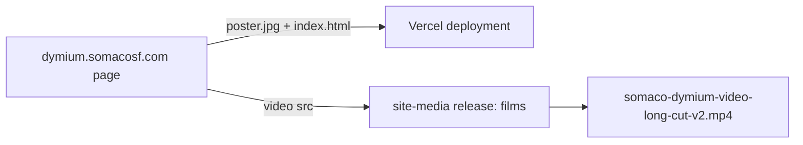

<!--
===============================================================================
file_id: SOM-DOC-10057-v1.0.0
name: README.md
description: SoMaCoSF/site-media — site asset hosting. Binary release assets for
  SoMaCoSF web properties (films and media files too large for the page deploy
  path). No source code lives here.
project_id: SOMACOSF
category: doc
tags: [assets, hosting, releases, media]
===============================================================================
-->

# site-media — SoMaCoSF site asset hosting

Binary asset hosting for SoMaCoSF web properties. Films and media files that are
too large for the page-deploy path are published here as **release assets** and
hotlinked by the sites that present them. No source code lives in this repo.

## Releases

- `films` — site film assets.
  - `somaco-dymium-video-long-cut-v2.mp4` — the Dymium governance-mapping long
    cut (v2, 3:01), played by <https://dymium.somacosf.com/>.

